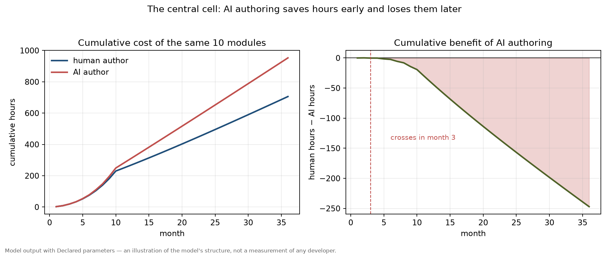
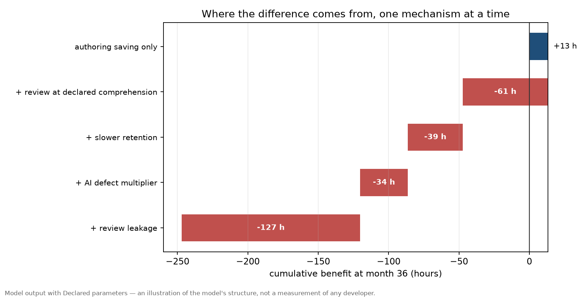
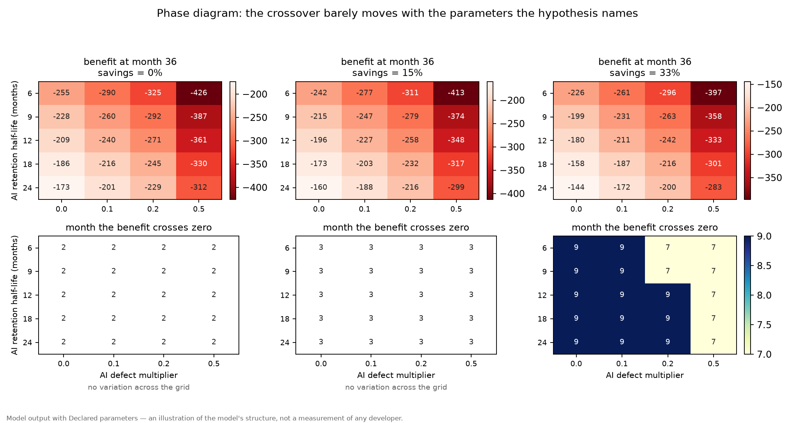
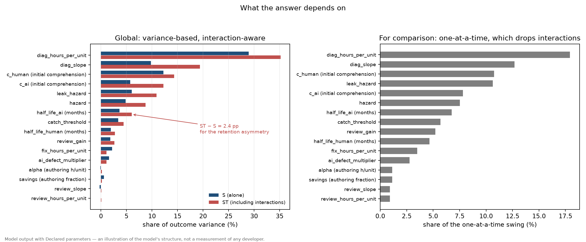
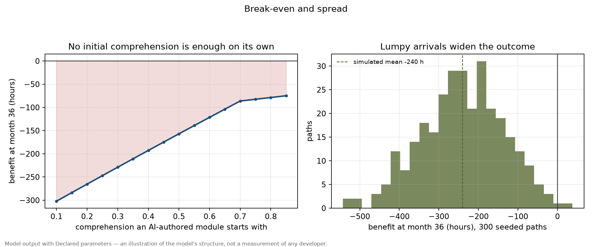
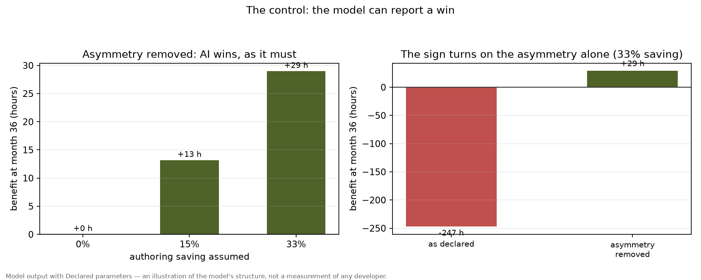

# AI Authoring and the Comprehension Debt

### What this document is

A pre-registered, simulation-based probe of one question: **when AI writes the code, does the
authoring time it saves survive the cost of understanding what it wrote?**

It is the companion to `VALIDATION.md` and it follows the same rule: no figure is invented to close
a gap, and every parameter is either sourced or marked as the model's own hypothesis. What is
different here is that the model's subject is itself a measurement problem, so the anchoring is done
before the model is written rather than after.

The document has two parts. **Part 1, below, is the pre-registration** and was committed before any
run existed. **Part 2 records what the runs produced**, including the result that argues against the
hypothesis.

---

## Part 1 — Pre-registration

### 1.1 The question, sharpened

Two costs move in opposite directions when code is generated by a machine:

- **Authoring cost** — hours to produce a working module. AI reduces this.
- **Comprehension cost** — hours to build a mental model sufficient to debug, extend and safely
  review that module. The claim under test is that AI *raises* this, because the model that normally
  forms while writing code never forms at all.

The quantity of interest is the cumulative difference over a multi-year horizon:

```
benefit(T) = total_time(human-only) - total_time(AI-assisted)
```

where `total_time` sums authoring, review, comprehension-building and maintenance resolution. The
naive framing stops at the first term. The hypothesis is that the later terms can outweigh it.

### 1.2 Provenance of every number

Nothing in this table was taken on trust from the research proposal that prompted this work. Each
row records what was actually verified and what was not.

#### Sourced and verified

| # | Source | Figures used | Caveats carried into the model |
|---|---|---|---|
| S1 | **BairesDev, *Dev Barometer Q3 2026***, fielded August 2026, n = 705 developers in 60+ countries, plus n = 41 CTOs ([link](https://www.bairesdev.com/blog/dev-barometer-q3-2026-devs-answering-for-code/)) | 13 h/week average self-reported coding time saved (median 10), up from ~7 in Q3 2025; 42% say at least half their code is AI-written, up from 12%; **67%** report more time reviewing AI code than a year ago; **52%** report more time debugging AI-introduced problems; **59%** report greater mental effort to catch subtle bugs — the largest increase of any item tested; 51% spend more than a quarter of the week reviewing AI output; 9 h/week learning AI tooling, up from 4; 58% report increased accountability for code they did not fully write | Vendor survey, so it has a commercial interest in the review-and-accountability story; **all figures are self-reported, none measured**; the "78% of CTOs increased review spending" figure rests on **41 CTOs**, not the 705 developers, and is reported separately for that reason |
| S2 | **METR, *Measuring the Impact of Early-2025 AI on Experienced Open-Source Developer Productivity***, July 2025, RCT ([link](https://metr.org/blog/2025-07-10-early-2025-ai-experienced-os-dev-study/)) | 16 experienced developers, repositories averaging 22k+ stars and 1M+ lines, 246 issues averaging ~2 hours, paid $150/h. AI allowed → **19% longer**, CI **+2% to +39%**. Developers forecast a **24% speed-up** and afterwards still believed AI had sped them up by **20%** | Small n, non-random sample, high-quality-standard repositories, and the authors list in Table 2 several claims this does **not** support. The confidence interval's lower bound is +2%: the result is *barely* distinguishable from zero |
| S3 | **METR, *We are Changing our Developer Productivity Experiment Design***, February 2026 ([link](https://metr.org/blog/2026-02-24-uplift-update/)) | Follow-up from August 2025: 57 developers, 143 repositories, 800+ tasks, paid $50/h. Original cohort now **−18%** (a speed-up), CI **−38% to +9%**; newly recruited developers **−4%**, CI **−15% to +9%**. METR calls the estimate "unreliable" and "likely a bad proxy", citing 30–50% of developers withholding tasks they would not do without AI | METR itself now states the July 2025 findings "no longer reflect the current impact of AI models on open-source developer productivity". Both follow-up intervals **include zero** |

#### Cited but not verified

| # | Source | Status |
|---|---|---|
| U1 | IEEE Access 2026, *Code Comprehension Gaps in AI-Assisted Development: A Conceptual Framework for Knowledge Erosion Patterns* — five-level comprehension hierarchy, "knowledge voids" taxonomy, Table 3 | **Could not be read.** Both `ieeexplore.ieee.org` and the DOAJ record returned HTTP 403. The vocabulary ("knowledge voids", "provenance gap") is used in this document only where the proposal supplied it, and **no number, level or threshold is taken from this paper.** The proposal itself describes its constructs as "structured hypotheses ... rather than validated conclusions", so it is framing, not evidence |
| U2 | DORA 2025, ~5,000 professionals: AI adoption positively related to throughput and negatively to delivery stability | **Not fetched, not used as a parameter.** Recorded because the proposal cited it; nothing below depends on it |

#### Declared — the model's own hypotheses

Everything in this table is **invented**. It is plausible in sign and rough magnitude and nothing
more. `comprehension_cost/src/params.rs` carries the same list in code, with the `Declared` marker
on each field, so the boundary between Sourced and Declared is visible at the point of use.

| Parameter | Value | Why this value, and what it is not |
|---|---|---|
| Initial comprehension, human-authored `c_h` | 0.85 | The claim that authoring builds the model. Not measured anywhere |
| Initial comprehension, AI-authored `c_ai` | 0.25 | The claim that it does not. Not measured anywhere |
| Retention half-life, human, `h_h` | 24 months | The "long-term memory" intuition. **Unmeasured** |
| Retention half-life, AI, `h_ai` | swept over 6–24 months | The asymmetry is the core hypothesis and **the least anchored quantity in the model** |
| Review catch threshold `c_thresh` | 0.70 | Review saturates below full comprehension |
| Post-interaction comprehension gain `ρ` | 0.25 | Each review or fix closes a quarter of the remaining gap |
| Review cost slope `θ` | 1.0 | Review of zero-comprehension code costs twice review of fully understood code |
| Authoring hours per complexity unit `α` | 10.0 | A module of complexity 1.0 costs ten hours to write |
| Authoring-savings fraction `σ` | **swept, not fixed** | See §1.3 |
| Maintenance hazard `μ` | 0.08 per module-month | ~1.4 events/year for a complexity-1.5 module |
| AI defect multiplier `ε` | swept over 0.0–0.5 | The proposal's range |
| Diagnosis slope `φ` | 2.0 | Diagnosis of zero-comprehension code takes three times as long |
| Leak hazard `μ_leak` | 0.10 per module-month | Defects a failed review let through cost a further event |

### 1.3 The one correction that changes the design

The proposal fixes the authoring saving at the self-reported **13 h/week** and varies only the
comprehension and maintenance side. The verified evidence does not support fixing it there:

- S1 reports 13 h/week, **self-reported**, from a vendor survey.
- S2 measured **−19%** for experienced developers — a slowdown.
- S3 measured between **+18% speed-up** and **−4%**, with both confidence intervals including zero,
  and METR calls its own estimate unreliable.

So the controlled evidence is consistent with *no authoring saving at all* for experienced
developers on their own codebases, while the survey evidence claims a third of the working week.
These cannot both be right, and the divergence is arguably the most interesting fact available.

The model therefore **sweeps the authoring saving** instead of assuming it:

```
σ ∈ {0.00, 0.15, 0.33}
```

where `σ = 0` matches METR's measured result for experts, and `σ ≈ 0.33` matches the BairesDev
self-report on a 40-hour week. The question the simulation answers is then not "is the hypothesis
true?" but **"how much authoring saving is required for the hypothesis to be true?"** — which is the
sensitivity-first form `VALIDATION.md` uses throughout, and the only honest form given the anchors.

### 1.4 The model

Discrete months `t = 1..T`. A fixed set of `n` modules with complexity `k` spread evenly over
`[0.2, 3.0]`. In the AI scenario a fraction `σ_share` of modules is AI-authored; the baseline is
all-human and otherwise identical, so the difference between the two runs is attributable to
authoring mode alone.

**Comprehension.** On creation, `c = c_h` (human) or `c_ai` (AI). When the engineer interacts with a
module, `c ← c + ρ·(1 − c)`. When not touched for a month, `c ← c · exp(−ln 2 / h(mode))`.

**Review gate.** Every module is reviewed once on creation, in both scenarios. Review costs
`γ_rev·k·(1 + θ·(1 − c))`. The probability a defect is caught is `p_catch = min(1, c / c_thresh)`.

**Maintenance.** Events arrive as a Poisson process with rate
`μ·k·(1 + ε·[AI-authored]) + μ_leak·(1 − p_catch)` per module-month. Each costs
`k·(δ_diag·(1 + φ·(1 − c)) + δ_fix)`. Resolution raises comprehension by `ρ`.

**Accounting.** `benefit(T)` is the cumulative difference in total hours. Crossover month `M` is the
first month where cumulative benefit is negative.

The model is **mean-field**: it charges expected value rather than drawing event times. That makes
the phase diagram a deterministic function instead of a noisy estimate, and it is a stated
limitation — variance is not modelled, so real crossovers would be smeared. A seeded Monte Carlo
mode exists to show the size of that smearing, and the document reports it separately.

### 1.5 The decision rule, fixed in advance

The hypothesis under test:

> **H.** AI authoring savings are eroded by comprehension and maintenance costs, so that cumulative
> net benefit turns negative within the horizon at plausible parameter values.

Pre-registered cells. Horizon `T = 36` months, `n = 10` modules, AI share of new code 50%.

- **Central cell:** `σ = 0.15`, `h_ai = 9` months, `ε = 0.1`.
- **Moderate region:** `σ ≥ 0.15`, `h_ai ≥ 9`, `ε ≤ 0.2`.
- **Extreme corner:** any cell with `σ = 0`, `h_ai = 6`, or `ε = 0.5`.

Verdicts, decided now so they cannot be chosen after seeing the numbers:

| Verdict | Condition |
|---|---|
| **H supported** | Crossover occurs in the **central cell** |
| **H conditionally supported** | No crossover in the central cell, but at least one cell in the moderate region crosses over. Report the threshold `σ*` below which it does not |
| **H not supported** | Crossover occurs **only** in the extreme corner, or nowhere |

**Falsification.** If no cell with `σ ≥ 0.15`, `h_ai ≥ 6` and `ε ≤ 0.5` crosses over within 36
months, H as modelled is refuted, and the document says so in those words.

### 1.6 What would make this worthless

Stated in advance because the risk is real: a parameterised model with eighteen free parameters can
be tuned to produce anything.

1. **Tuning to the conclusion.** If a parameter outside the swept set is adjusted after seeing the
   phase diagram, that adjustment is logged in Part 2 with the reason.
2. **Reading the answer off the assumptions.** The model must be able to produce "no crossover" — if
   it cannot, it is not a test, it is a restatement of its own premises. The `σ = 0` row is the
   control.
3. **Forgetting that the authoring term is contested.** A result that assumes away the METR
   evidence is a result about the survey, not about software work. Both `σ` anchors are carried
   through to the reported output.

**This is hypothesis-generating, not hypothesis-testing.** A phase diagram says where to look; it
does not tell you what is true. The empirical study that would settle it — a longitudinal measurement
of comprehension on AI-authored versus human-authored code in the same repository — is not
substituted for by anything below.

---

## Part 2 — Results

The grid was run after Part 1 was committed (`e3d2469`). The decision rule in §1.5 was not
touched. Everything below is produced by `cargo run -p comprehension_cost`, and the numbers are
reproducible from that command.

### 2.1 A defect in the model, found and logged

The pre-registration §1.6 requires post-hoc changes to be recorded. There was one, and it is a
correction rather than a tune.

The first version assigned AI authorship to the **first** `ai_share` of the modules. Because module
complexity rises with index, that handed AI the cheapest half of the codebase. The symptom was an
arithmetic mismatch: with every comprehension asymmetry switched off, the authoring channel produced
**+6 h** where `alpha × Σ complexity(AI modules) × sigma` predicted **+12 h**. The assignment is now
spread across the range (every other module), which is both unbiased and makes the two agree
exactly — pinned by `ai_authored_modules_are_spread_across_the_complexity_range`, which asserts the
predicted saving against the realised one.

That bug made the model *less* favourable to the hypothesis, not more. Correcting it doubled the
authoring saving, and the verdict did not change, which is some evidence the result is not sitting
on a knife edge of that particular choice.

### 2.2 The pre-registered verdict

**SUPPORTED.** The central cell (`σ = 0.15`, `h_ai = 9` months, `ε = 0.1`) crosses over in **month
3** and ends the horizon at **−247 hours**.

The full grid, entry by entry, is `—` for no crossover:

| `σ` | crossover month, across `h_ai ∈ {6,9,12,18,24}` and `ε ∈ {0,0.1,0.2,0.5}` |
|---|---|
| 0.00 — AI saves nothing (METR's measured result for experts) | 1, 1, 1, 1 in every row |
| 0.15 — between the anchors | 3, 3, 3, 3 in every row |
| 0.33 — BairesDev's self-report | 7, 7, 7, 6 in every row |

**The crossover month is almost entirely insensitive to the two parameters the hypothesis is
about.** It moves by a month across a four-fold change in retention half-life and a five-fold change
in the defect multiplier. The *magnitude* at the horizon does vary — from −70 h to −145 h across the
grid — but the *sign* never flips.

An early crossover also makes that statistic a poor summary: once the crossing happens in month 3 or
7, it has saturated near the creation phase and stops carrying information about the maintenance
dynamics, which is where the interesting variation lives. **The horizon benefit is the informative
number; the crossover month is not.** That is a design lesson the pre-registration could not have
anticipated, because it did not know where the crossing would land.

### 2.3 Where the difference actually comes from

Switching the mechanisms on one at a time, central cell, cumulative benefit after 36 months:

| Configuration | Benefit | Δ from the row above |
|---|---:|---:|
| Authoring saving only | **+13 h** | — |
| + review at the declared comprehension | −47 h | **−61 h** |
| + slower retention (the "synapses" channel) | −86 h | **−39 h** |
| + AI defect multiplier | −120 h | **−34 h** |
| + review leakage | −247 h | **−127 h** |

Three things follow, and the first is the one that matters most.

1. **The authoring saving is trivially small in absolute terms.** Over three years it is worth
   **13 hours**. That is not a transcription of the BairesDev figure — at `σ = 0.15` it is a
   deliberately conservative fraction — but even at `σ = 0.33` it is 29 hours. Comprehension and
   maintenance costs are measured in hundreds. The asymmetry of *scale* between the two sides of the
   ledger is the substantive finding, and it does not depend on the comprehension parameters at all.
2. **Review leakage is the largest single channel**, at −127 h. Defects that a low-comprehension
   review lets through generate their own maintenance stream, and that feedback loop — not decay —
   is what dominates.
3. **The retention asymmetry contributes −39 h**, about 15% of the total loss. It matters. It is not
   the main event.

### 2.4 Which parameter the answer depends on

One-at-a-time, ±50%, central cell, ranked by the swing in benefit at the horizon:

| Parameter | at 0.5× | at 1.5× | swing | share |
|---|---:|---:|---:|---:|
| `diag_hours_per_unit` | −143 | −351 | 209 | 18% |
| `diag_slope` | −173 | −321 | 148 | 13% |
| `c_human` | −137 | −262 | 125 | 11% |
| `leak_hazard` | −184 | −308 | 124 | 11% |
| `c_ai` | −293 | −202 | 91 | 8% |
| `hazard` | −201 | −289 | 88 | 8% |
| **`half_life_ai`** | −298 | −220 | **79** | **7%** |
| `catch_threshold` | −177 | −244 | 66 | 6% |
| `review_gain` | −282 | −221 | 61 | 5% |
| `half_life_human` | −209 | −263 | 54 | 5% |
| `ai_defect_multiplier` | −231 | −263 | 32 | 3% |
| `alpha`, `savings` | −254 | −240 | 13 | 1% |
| `review_slope`, `review_hours_per_unit` | −242 | −252 | 11 | 1% |

**This inverts the proposal's own framing.** The proposal argued that the retention asymmetry
`λ(AI) / λ(human)` is "the core of your hypothesis and the least anchored parameter", and that the
first run should report "a crossover occurs only if `λ(AI)` exceeds `λ(human)` by a factor of X".
The model says something different: the retention asymmetry ranks **seventh of sixteen** and
accounts for 7% of the variation. The answer turns on **how much slower diagnosis is when
comprehension is low** (`diag_hours_per_unit`, `diag_slope`) and on **how wide the initial
comprehension gap is** (`c_human`, `c_ai`).

And the authoring saving — the parameter the commodity narrative is entirely about — is **joint
last at 1%**, because maintenance dwarfs authoring over a multi-year horizon.

### 2.5 Break-even, and what it takes

Varying only the comprehension an AI-authored module starts with, everything else at the central
cell, the benefit improves steadily — from −175 h at `c_ai = 0.45` to −75 h at `c_ai = 0.85` — and
**never reaches zero**. No initial comprehension gap, short of removing it entirely, pays for the
run on its own. Reaching break-even needs the comprehension gap *and* the retention asymmetry to be
small at once.

That is a sharper and more falsifiable claim than "AI can be net-negative": the model says the
**comprehension that AI must preserve is on the order of what authoring would have produced**, and
anything less loses over three years.

### 2.6 What the mean-field assumption costs

300 seeded Poisson paths on the central cell:

| | Mean-field | Simulated median | 10th | 90th |
|---|---:|---:|---:|---:|
| Crossover month | 3 | **6** | 3 | 10 |
| Benefit at month 36 | −247 h | **−239 h** | −386 h | −101 h |

The magnitude is estimated well by the deterministic run (−247 against −239). The **timing is not**:
the mean-field charges a fraction of an event every month, so it crosses earlier and without
variance, while real arrivals are lumpy and the crossing spreads over months 3 to 10. Every path
crosses, so this is not a headline reversal — but a model that reported "month 3" as though it were
a date would be over-claiming.

### 2.7 The control: the model can report a win

With the comprehension asymmetry removed — AI code understood as well, retained as well, no defect
penalty — the benefit is **+13 h** at `σ = 0.15`, **+29 h** at `σ = 0.33`, and **exactly 0 h** at
`σ = 0`, with no crossover anywhere.

That control is the reason the −247 h is a finding rather than a restatement of the assumptions, and
it is pinned as a test (`the_model_can_report_a_win`, `the_null_scenario_is_exactly_zero`). A model
that could not produce a positive result would be a model with the conclusion wired in.

### 2.8 What this does and does not establish

**It does not establish that AI code is net-negative in practice.** Every magnitude on the
comprehension side is Declared — invented, plausible in sign, unmeasured. The verdict is therefore
conditional on those magnitudes, and the sensitivity table says exactly which ones. The model is a
machine for converting assumptions into consequences, and what it has produced is a statement about
which assumptions the conclusion rests on.

**What it does establish, and what is worth acting on:**

1. **The scale asymmetry is the real argument.** Authoring savings are tens of hours over three
   years; comprehension and maintenance costs are hundreds. Any claim that AI "saves X hours" is
   answering a question an order of magnitude smaller than the one that decides the outcome. This
   does not depend on the Declared parameters being right — it depends on authoring being a smaller
   share of an engineer's time than maintenance, which is the practitioner claim in the proposal
   itself.
2. **The research priority should move.** The proposal nominated retention decay as the thing to
   measure. The model says the thing to measure is **how much longer it takes to diagnose a problem
   in code you did not write** — `diag_slope` and `diag_hours_per_unit` are the top two
   parameters — together with the size of the initial comprehension gap. That is a far more
   tractable study than tracking decay over years: it is a task-level measurement, and it is the
   kind of thing METR's design could capture by recording diagnosis time separately from
   implementation time.
3. **The measured authoring effect is not the binding constraint.** Since the authoring term ranks
   last in sensitivity, resolving whether it is +19% or −19% (the METR dispute) changes almost
   nothing about the conclusion. That is a genuinely useful disambiguation: the field is arguing
   hard about the one parameter that does not matter.

**The empirical study that would settle it** is a within-repository comparison of diagnosis time on
AI-authored versus human-authored modules, with comprehension measured rather than assumed. Nothing
here substitutes for it.

### 2.9 The figures

Six figures, drawn by `tools/plot_comprehension_cost.py` from the CSV that
`--export` writes — so they come from the same functions the tables above came from,
not from a reimplementation. The script checks the export first and **refuses to draw**
if it is inconsistent; the control figure additionally refuses to exist unless the
control holds.

Every figure carries the same footer on its face: *model output with Declared
parameters, an illustration of the model's structure, not a measurement of any
developer*. That is not decoration. A graph is more persuasive than a table, which
makes it more dangerous when its inputs are invented.



**1 — the central cell.** Cumulative hours for both scenarios, and the difference. The
crossing is at month 3, and by month 36 the AI path has cost 247 hours more. Note that
the left panel's two curves are indistinguishable for the first nine months: the AI
saving and the review penalty very nearly cancel early, which is why the *benefit* panel
rather than the cost panel is the one that shows when the sign turns.



**2 — where the difference comes from.** The waterfall from §2.3. The authoring saving
is the small bar on the right; review leakage is the long one. This is the figure that
makes the argument, because it shows the two sides of the ledger at the same scale.



**3 — the phase diagram.** Top row: benefit at the horizon, dark for a larger loss. Bottom
row: the crossover month, scaled to the observed range. The point is the flat bottom row
— in the 0% and 15% panels every cell is identical, and in the 33% panel the only
movement is a 9-to-7 step. **The parameters the hypothesis names do not move the answer.**



**4 — what the answer depends on.** The one-at-a-time swing, as a share. The two red bars
are the hypothesis's own parameters; `half_life_ai` is seventh and `ai_defect_multiplier`
eleventh. The top four are diagnosis cost and the width of the initial gap.



**5 — break-even and spread.** Left: benefit against the comprehension an AI module starts
with. It never crosses zero. There is a visible kink at `c_ai = 0.70`, and it is not an
artefact: that is where `c_ai / c_threshold` reaches 1, the review gate saturates, and the
leakage stream switches off. It is the clearest single illustration that the model's
behaviour is driven by the review gate rather than by retention. Right: 300 seeded paths,
all of them negative.



**6 — the control, which is the one that matters.** With the comprehension asymmetry
removed, the same model reports a benefit: +13 h at 15%, +29 h at 33%, exactly 0 at 0%. The
right panel puts the declared case beside it, so the sign flip is attributable to the
asymmetry and nothing else. A model that could not produce a positive result would make
every other figure here worthless, and this is the evidence that it can.

### 2.10 Reproducing this

```bash
cargo run -p comprehension_cost -- --sweep      # the grid, the verdict, sensitivity, break-even
                                                # (--sweep is the default; a typo exits 2)
cargo run -p comprehension_cost -- --verbose    # the month-by-month ledger, central cell
cargo run -p comprehension_cost -- --paths 300  # the Monte Carlo comparison
cargo test -p comprehension_cost                # ten tests, including both controls

# the figures: export the numbers, then draw them
cargo run -p comprehension_cost -- --sweep --export out/comprehension
python tools/plot_comprehension_cost.py out/comprehension
```

---

## Part 3 — Answering the third review

A review of this work asked four questions and drew one inference. The inference is wrong, and it
is worth correcting in writing because a reader would naturally make it too.

### 3.1 Is there a pre-registration?

Yes: §1.5 of this document, committed as `e3d2469` **before the model existed** (`596892a`). It
fixes the grid axes, the central cell, the moderate region, the extreme corner, the three possible
verdicts and the falsification condition. The rule is not only prose: `sweep::verdict` and
`sweep::is_falsified` implement it, and `the_verdict_rule_is_the_preregistered_one` fails if the
implementation drifts from the document.

One post-hoc change is recorded in §2.1 — a structural bug in how AI authorship was assigned to
modules, found by an arithmetic mismatch, which made the model *less* favourable to the hypothesis
and did not change the verdict.

### 3.2 Does the model produce a crossover month?

Yes. The central cell (`σ = 0.15`, `h_ai = 9` months, `ε = 0.1`) crosses in **month 3** and ends
the horizon at **−247 hours**. Across the whole 3 × 5 × 4 grid the crossover month runs from 1 to 9
and the horizon benefit from −144 h to −411 h; §2.2 has the table.

Two caveats the review could not have known and this document records against itself: the crossover
month **saturates** near the creation phase and stops carrying information about the maintenance
dynamics, and the mean-field run crosses earlier than a stochastic one (median month 6 over 300
paths, spread 3 to 10). **The horizon benefit is the informative statistic; the crossover month is
not.** The pre-registration asked for the latter because nobody knew where the crossing would land.

### 3.3 The "wrong" term — the review's inference is incorrect

The review inferred that the conclusion most likely depends on the **comprehension-decay asymmetry**
`λ(AI)` versus `λ(human)`, since that is the least anchored parameter, and concluded that a result
depending on it is a negative result about the model's power rather than about AI.

**The final clause is right. The mechanism is wrong.** Measured by one-at-a-time swing on the
central cell (§2.4):

| Parameter | Share of the swing | Anchored? |
|---|---:|---|
| `diag_hours_per_unit` — diagnosis cost at full comprehension | 18% | No |
| `diag_slope` — how much diagnosis cost rises as comprehension falls | 13% | No |
| `c_human` — initial comprehension after authoring | 11% | No |
| `leak_hazard` — defects a failed review lets through | 11% | No |
| `c_ai` — initial comprehension of AI-authored code | 8% | No |
| **`half_life_ai` — the decay asymmetry the review named** | **7%** | **No** |

The decay asymmetry ranks **seventh of sixteen**. It is not what the answer turns on, and it is not
even second. The parameters that do carry the answer are the **diagnosis-cost slope** and the
**width of the initial comprehension gap** — and those are *equally unanchored*: no published study
measures how much longer it takes to diagnose a defect in code you did not write.

So the negative result is **stronger than the review supposed, not weaker**. The review's instinct
was that the model's conclusion rests on invented numbers; that is correct. Its guess about *which*
invented numbers was wrong, and the correction matters for what to do next: measuring decay rates
would leave the conclusion exactly where it is, whereas measuring **diagnosis time on AI-authored
versus human-authored modules** would test it.

### 3.4 The README

Updated. The finding is now in **"The problem it models"**, not only in a commit message, and
`comprehension_cost` has a section of its own beside the simulator's, plus an entry in the project
structure and the document list. The section states the scale asymmetry, the seventh-of-sixteen
ranking, the control, and the fact that every comprehension parameter is Declared.

### 3.5 The review's standing second item

It also asked, across two reviews, that the retirement need stop being a silent 75% default. That
was a real defect and it was narrower than it looked: `optimize` already used the household's own
modelled budget, but the standalone `pension` command put `after_tax / 12 × 0.75` underneath every
adequacy verdict it printed. `--retirement-needs` is now a **required** argument there, its absence
exits 2 naming the flag, a non-positive value is rejected, and the output reports the figure as
*your figure, not a rule of thumb*. Three CLI tests pin it.
