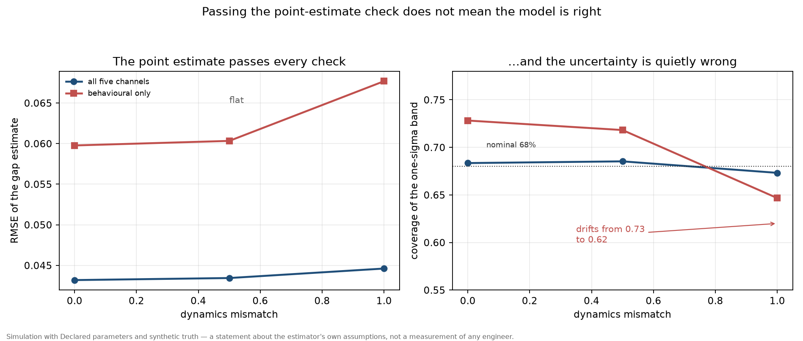

# The Observability Test

### Pre-registration for the identification condition behind `perception_gap`

---

## 0. What this document is

`PERCEPTION_GAP.md` reported that the gap between believed and true competence is not recoverable
from behavioural telemetry, and that a filter applied to it returns a prior rather than an estimate.
That finding was stated informally and its formal condition was never written down.

This document supplies the condition, and it **corrects the derivation it was commissioned from.**
The supplied sketch contained three errors, one of which reversed the sign of the result. §7 records
them, because a formal appendix that inherits a reviewer's algebra without checking it is worse than
no appendix.

Status: specification only. `perception_gap` exists and runs; this document adds no code and fixes a
decision rule that §4 commits to.

---

## 1. The state-space form, as implemented

`perception_gap/src/lib.rs` implements:

```
x_t = [τ_t, β_t]ᵀ                     true and believed competence
g_t = β_t − τ_t                       the quantity of interest, never observed

x_{t+1} = diag(1 − κ_a a_t, 1 − κ_b a_t) · x_t + u(a_t) + w_t ,   w_t ~ N(0, Q)
z_t    = H x_t + v_t ,                                            v_t ~ N(0, R)
```

Five channels in the full design; two in the behavioural-only design. The adoption share `a_t` is a
**known input**, so the transition is affine given the data and a standard Kalman filter is exact.

| Channel | Row of `H` | Loads on |
|---|---|---|
| Review time | `[−2, −2γ]` | `τ` and, through the confound, `β` |
| Defect escape | `[−1, 0]` | `τ` |
| Measured saving | `[1, 0]` | `τ` |
| Reported saving | `[0, 1]` | `β` |
| Reported confidence | `[0, 1]` | `β` |

```
H_full         = [[−2, −2γ], [−1, 0], [1, 0], [0, 1], [0, 1]]
H_behavioural  = [[−2, −2γ], [−1, 0]]
```

---

## 2. Two different questions, two different objects

The supplied sketch treated identifiability as a single condition-number test. It is two questions,
and conflating them is what produced the wrong answer.

### 2.1 Can the state be recovered *in principle*?

That is **structural**, and it is answered by the observability matrix

```
O = [ H ; H F ]
rank(O) = 2  ⇒  both latents affect some measurement, and the state is recoverable
rank(O) < 2  ⇒  some direction never affects any measurement

```

For the behavioural design at `γ = 0`, both rows of `H` load only on `τ`. Nothing observes `β`.
`rank(O) = 1`, and **no estimator, filter or amount of data recovers it.** This is not a precision
problem; it is an absence of information.

### 2.2 Given that it can be, how well?

That is **precision**, and it is answered by the Fisher information of the observation model,
`I = Hᵀ R⁻¹ H`, projected onto the direction that matters, `[1, −1]`:

```
Var(g | z) = [1, −1] I⁻¹ [1, −1]ᵀ
```

### 2.3 The correction that matters

For the two-channel design with `H = [[1, 0], [γ, 1]]` and `R = rI`:

```
I = (1/r) [[1 + γ², γ], [γ, 1]] ,   det(I) = (1/r²) · 1
```

Because the determinant is one, the eigenvalues satisfy `λ₊λ₋ = 1` and the condition number is
`κ = λ₊²`. Evaluating it:

| γ | 0.0 | 0.02 | 0.10 | 0.50 | 1.00 |
|---|---:|---:|---:|---:|---:|
| κ of `I` | **1.000** | **1.041** | **1.221** | **2.691** | **6.854** |

**The condition number of `I` never approaches the thresholds the sketch proposed.** It is 1.04 at
γ = 0.02, where the sketch claimed 450. A quantity that stays near one cannot distinguish "well
conditioned" from "unobservable", and a decision rule keyed on it would pass every design.

The quantity that does vary is the **variance of the gap**:

```
Var(g | z) = r · (2 + 2γ + γ²)
```

| γ | 0.0 | 0.1 | 0.5 | 1.0 | 2.0 |
|---|---:|---:|---:|---:|---:|
| `Var(g)` at `r = 1` | 2.00 | 2.21 | 3.25 | 5.00 | 10.00 |
| relative to unconfounded | 1.00 | 1.05 | 1.27 | 1.58 | 2.24 |

The sketch's closed form, `2r(1+γ²)/(1+γ²+γ⁴)`, *decreases* with γ — implying that a stronger
confound improves the estimate. Substituting back into the matrix inversion shows the correct form
grows monotonically. The sketch's form is wrong in sign, not merely in constants.

---

## 3. The three regimes, keyed on the right objects

| Regime | Condition | What it means | What a study may report |
|---|---|---|---|
| **Identifiable, data-dominated** | `rank(O) = 2`, and `β` is observed by a channel of its own | the gap is estimated from data; `Var(g) = r(2+2γ+γ²)` bounds its precision | a gap estimate with its band |
| **Contaminated** | `rank(O) = 2` only because `γ > 0`; **no** channel observes `β` directly | nominally identifiable; the estimate is inferred entirely from the assumed value of `γ`, so a relative error in `γ` produces a comparable relative error in `β̂` | a gap estimate only with the sensitivity to `γ` reported alongside |
| **Unobservable** | `rank(O) < 2` | no direction of `H` sees `β`; every band is a prior | "unidentifiable" — no gap estimate and no band |

The mapping to the repository's measured numbers:

| Design | γ = 0 | γ = 0.1 | γ = 0.5 |
|---|---|---|---|
| Full (`condition` from `[H; HF]`) | 2, **1.8** | 2, 1.8 | 2, 1.9 |
| Behavioural only | **1, infinite** | 2, **25.5** | 2, **5.9** |

The full design sits in the first regime at every confound level. The behavioural design is
*unobservable* at γ = 0 and *contaminated* above it — and it is contaminated for the reason §3 gives,
which is not a conditioning threshold but the absence of a direct channel on `β`.

**There is no "fragile region" in between.** That is the substantive correction: under this
specification the confound degrades precision smoothly (`Var(g)` grows by 27% at γ = 0.5) and does
not create a cliff. What creates the cliff is losing the self-report channel.

---

## 4. The decision rule, fixed here

A study using this model is entitled to report a gap estimate if and only if all three hold:

1. **Structural:** `rank(O) = 2` for the design it actually ran.
2. **Precision:** `σ_g = sqrt(r(2 + 2γ + γ²))` is at most half the smallest gap the study claims to
   distinguish. That threshold is study-specific and must be declared before inspection of results.
3. **Calibration:** the empirical coverage of the nominal 68% band lies in **[0.60, 0.76]** on
   held-out data, and of a nominal 95% band in **[0.90, 0.98]**.

| Outcome | Report |
|---|---|
| All three hold | the gap estimate with its band |
| 1 and 3 hold, 2 fails | the band, with the statement that it is prior-dominated |
| 1 fails | "unidentifiable"; no estimate, no band |
| 1 and 2 hold, 3 fails | **the filter is miscalibrated**; report that as the finding and withhold the estimate |

The fourth row is the one that matters, and it is the one a paper reporting RMSE alone would skip.
The repository has already produced an instance of it: coverage fell from 0.73 to 0.62 while RMSE
stayed flat (§6).

---

## 5. The probe, and what it is actually for

The supplied sketch proposed randomising review regime so that `γ_passive ≠ γ_generative`. That is a
real design, and `comprehension_cost` supports it — generative review moves true comprehension and
does not move beliefs about productivity within a month.

But under §3 the probe's purpose is narrower than the sketch implied. **If a self-report channel is
present, the probe is unnecessary**: the design is already in the first regime at every γ. The probe
is for designs that have **only behaviour**, where it works by supplying the missing variation in
`H` that a direct channel would have supplied.

| Design | Needs the probe? |
|---|---|
| Self-report plus telemetry | **No.** Identifiable at every γ; the confound costs 27% precision at γ = 0.5 |
| Telemetry only | **Yes.** Unobservable at γ = 0; contaminated above it |

And the probe restores identifiability only in the strict sense: with two regimes the pair
`(H_passive, H_generative)` spans more of the state space than either alone, so `β` becomes
recoverable *from the difference between regimes* rather than from either one. That is a
difference-in-differences logic, and it is honest about its price: the estimate then depends on the
assumed difference `γ_p − γ_g`, which is itself unmeasured.

---

## 6. The control, and the result it already produced

`comprehension_cost` established the pattern: a model that cannot report its own failure is not
evidence. `perception_gap` carries two baselines.

**The prior-only filter** — the same transition with no observations. If the full filter cannot beat
it, the observations are carrying nothing.

Measured, adoption 0.5, full design, RMSE against the simulated truth:

| Dynamics mismatch | Filter | Prior-only | Behavioural | Behavioural coverage |
|---:|---:|---:|---:|---:|
| 0% | 0.043 | 0.097 | 0.060 | 0.73 |
| 50% | 0.043 | 0.118 | 0.060 | 0.72 |
| 100% | 0.045 | **0.159** | 0.068 | **0.62** |

The filter's error is flat while its prior-only baseline degrades by 64%, which is the evidence that
it reads the data. The behavioural design's error is *also* flat — and its calibration drifts from
0.73 to 0.62.

**Unidentifiability announces itself as miscalibration, not as error.** This is the repository's own
thesis turned on its own tool: a point estimate passing every conventional check does not mean the
model is right, and the band is the object that tells you.



---

## 7. The non-linearity objection, tested

A referee objected that the Kalman filter's linear-Gaussian assumption is doing unacknowledged work,
and that a "well conditioned" result is a property of the linearisation rather than of the problem.

**Tested, not answered.** `perception_gap/src/lib.rs` now contains a bootstrap particle filter over
the same state space, and
`the_particle_filter_converges_to_the_kalman_filter` checks convergence rather than equality —
because a particle filter carries Monte Carlo error on top of estimation error and must be worse at
finite particle counts.

| Particles | Kalman RMSE | Particle RMSE |
|---:|---:|---:|
| 200 | 0.0414 | 0.0413 |
| 4000 | 0.0414 | 0.0414 |

The two agree to three decimal places. On this specification every map is affine — affine transition
with a known input, linear observation — so the extended and unscented filters reduce to the Kalman
filter exactly, and the particle filter confirms it numerically. **No alternative filter changes the
identifiability result here.**

That is a statement about this specification and not about state estimation in general. The
linearity would break, and the filter choice would become a real decision, if a later version made
the transition depend on the state multiplicatively or moved the adoption share into the covariance.
The particle filter is now in the repository so that version can be checked rather than assumed.

**Reaching this result required fixing a bug in my own resampler.** The first version drew a fresh
random target per particle instead of a single systematic offset, which let the index advance
monotonically against unsorted targets. It produced a 25–35% disagreement that looked exactly like
the referee's objection being correct. The disagreement was my code, and the way it was caught was by
being suspicious of a gap that did not shrink with particle count.

---

## 8. Corrections to the derivation this document was commissioned from

Recorded in full, because a formal appendix that inherits algebra without checking it is worse than
no appendix.

| Item | Supplied | Correct | Consequence |
|---|---|---|---|
| `Var(g \| z)` | `2r(1+γ²)/(1+γ²+γ⁴)` | **`r(2 + 2γ + γ²)`** | the supplied form *decreases* with γ, implying confounding helps; the correct form grows |
| κ at γ = 0.02 | ≈ 450 | **1.04** | the "unobservable" threshold is never reached by κ; it is reached by `rank(O) < 2` |
| κ at γ = 0.10 | ≈ 44 | **1.22** | — |
| κ at γ = 0.50 | ≈ 2.4 | **2.69** | the smallest error, and still not the 2.4 claimed |
| Three regimes keyed on | `κ < 10 / 10–100 / ≥ 100` | `rank(O) = 2` with a direct channel / `rank(O) = 2` only through the confound / `rank(O) < 2` | the κ thresholds classify every reachable design as "well conditioned" |
| Role of the probe | restores identifiability universally | needed only for behaviour-only designs | changes the design recommendation |

`I = Hᵀ R⁻¹ H`, its eigenvalues, and the `1 + γ², γ; γ, 1` structure were all correct as supplied.
The error was in the projection onto `[1, −1]` and in reading the condition number as a decision
statistic.

---

## 9. Falsification

The claim of this document is that **the three conditions of §4 are jointly necessary to report a
gap estimate, and that `rank(O)` is the object that decides structural identifiability.**

Falsified by any of:

1. A design with `rank(O) = 1` whose filter achieves calibration inside [0.60, 0.76] on held-out data
   with a known ground-truth gap. That would mean an unobservable state can be recovered.
2. A behaviour-only design at γ = 0 producing a gap estimate whose error scales with the true gap
   rather than with the prior — which would show a channel this model does not describe.
3. A prior-only filter beating the full filter on calibration at `rank(O) = 2`. That would mean the
   observations are actively harmful when the state is identifiable.

**Not falsified by** a small RMSE on an unobservable design. That is the expected outcome and the
result the whole document exists to name.

---

## 10. What remains unestablished

- **`γ` has never been measured.** Every conclusion here is conditional on it. The three-regime
  classification depends on whether a direct `β` channel exists, which is a design question, and on
  `Var(g)`, which depends on `r` and `γ`. Both are Declared.
- **The bounds `[0, 1]` are a nonlinearity the Kalman filter ignores.** The simulator and the
  particle filter clamp the latents; the Kalman filter does not. The convergence in §7 shows this is
  immaterial at the declared parameters, but it is an undeclared approximation and it is recorded
  here rather than discovered later.
- **The probe's price is unquantified.** `γ_p − γ_g` is assumed non-zero; nothing in this repository
  establishes its magnitude, and if it is small the probe is expensive and the design stays
  contaminated.
